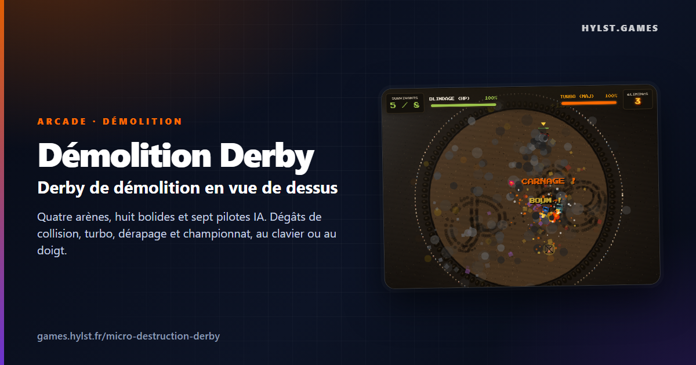

# Démolition Derby

**Derby de démolition en vue de dessus, quatre arènes et huit bolides.**

Démolition Derby est un jeu d'arcade rétro inspiré des bornes de la fin des années 80. Le joueur choisit un bolide, une arène et un mode, puis affronte sept pilotes contrôlés par l'IA. Les dégâts de collision s'accumulent, le turbo et le dérapage se gèrent en temps réel, et quatre environnements changent l'adhérence.

Joue ici : [games.hylst.fr/micro-destruction-derby/](https://games.hylst.fr/micro-destruction-derby/)



Illustration de présentation générée par IA.

## Contrôles

| Action | Clavier | Tactile |
|---|---|---|
| Accélérer | Flèche haut, W, Z | Bouton ▲ |
| Reculer | Flèche bas, S | Bouton ▼ |
| Tourner | Flèche gauche ou droite, A ou D, Q | Boutons ◀ et ▶ |
| Dérapage | Espace | Bouton DÉRAPAGE |
| Turbo | Maj ou B | Bouton TURBO |
| Plein écran | bouton dédié | bouton dédié |

## Fonctionnalités

- Quatre arènes : fosse de terre, usine toxique, dépôt glacé et cratère en feu.
- Huit bolides aux caractéristiques distinctes.
- Trois modes : Carnage Survie, Championnat en quatre manches et Match à mort.
- Dégâts de collision, nitro, dérapage et sept pilotes IA.
- Championnat en quatre manches avec score cumulé.
- Direction assistée par canvas, rendu rétro et effets sonores synthétisés.
- Commandes tactiles pendant la partie.
- Aucune donnée conservée dans le navigateur.

## Technique

- React 19, TypeScript, Vite 7 et Tailwind CSS 4.
- Rendu Canvas 2D, image de héros quantifiée en 256 couleurs.
- Polices Press Start 2P et VT323 auto-hébergées dans `public/fonts/`.
- Build en un seul fichier `index.html`.
- Aucune requête réseau pendant la partie, aucun compte, aucun cookie.

```bash
npm ci
npm run build
```

Le build sort dans `dist/` et se sert sous `/micro-destruction-derby/`.

## Structure

```
src/App.tsx                        présentation, sections et pied de page
src/components/InteractiveDerbyGame.tsx  moteur, rendu, IA, HUD et tactile
src/utils/arenas.ts                arènes et décors
src/utils/audio.ts                 musique et effets sonores synthétisés
src/types/game.ts                  types du jeu
```

## Licence

AGPL-3.0-or-later. Voir `LICENSE`.

Jeu créé par Geoffroy Streit (Hylst) avec l'aide d'une IA.
